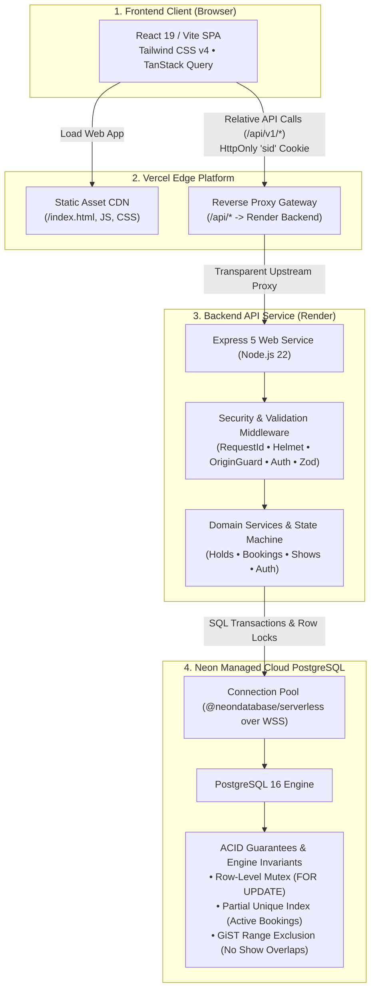
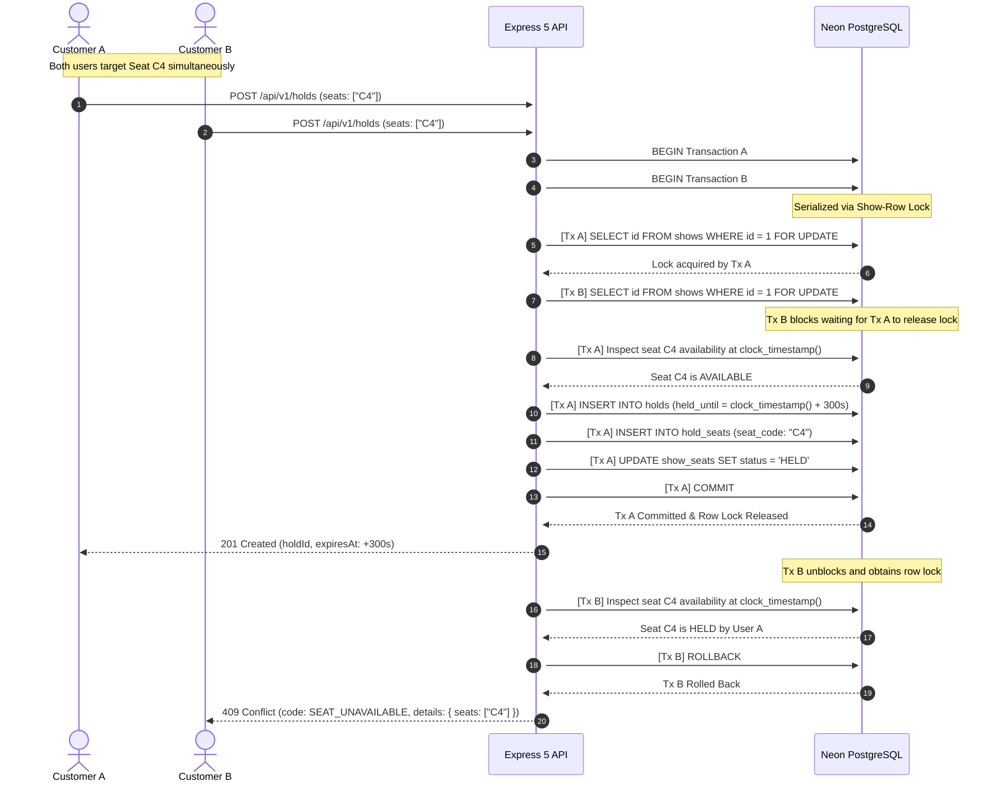

# Lumiere — Movie Ticket Booking Engine

Production-grade online cinema ticket booking platform built for **one cinema with one screen (80 seats: A1–H10)**. Features strict concurrency-safe booking guarantees, database-backed atomic holds, and comprehensive administrative show and movie management.

---

## 1. Scope & Flow Verification Truth Table

Lumiere satisfies all 7 mandatory business flows (**F1–F7**) and all 3 optional bonus flows (**B8–B10**) specified in the engineering blueprint.

| ID      | Flow                                          | Description & Required Observable Behavior                                                                                                                                                                                                             | Implementation & Status         |
| :------ | :-------------------------------------------- | :----------------------------------------------------------------------------------------------------------------------------------------------------------------------------------------------------------------------------------------------------- | :------------------------------ |
| **F1**  | **Signup & Session Lifecycle**                | Secure user registration with Argon2id password hashing (min 8 chars), duplicate email conflict prevention, generic credential authentication, server-revocable 32-byte opaque session cookies, and role-based access control (`CUSTOMER` vs `ADMIN`). | **Complete & Verified**         |
| **F2**  | **Movie Catalog & Showtime Discovery**        | Public catalog browsing with real-time poster fallbacks, detailed movie views, and upcoming shows grouped by local calendar date (`Asia/Kolkata` IST) displaying real-time available seat counts.                                                      | **Complete & Verified**         |
| **F3**  | **Interactive 80-Seat Map**                   | Backend-driven 80-seat auditorium visualizer (`A1`–`H10`) with curved screen orientation, dynamic state coloring (`AVAILABLE`, `HELD`, `BOOKED`), occupancy counters, and real-time occupied seat disabling.                                           | **Complete & Verified**         |
| **F4**  | **Atomic Selection & 5-Minute Holds**         | Flexible 1–6 seat selection with live price tabulation, show-row `FOR UPDATE` lock mutex, atomic 300-second reservation holds, live countdown timer, and automatic expiration without background workers.                                              | **Complete & Verified**         |
| **F5**  | **Mock Payment & Atomic Confirmation**        | Controlled mock payment handling (`success` vs `failure`). Successful payment confirms booking atomically and seals seat ownership; failed payment leaves seats held for retry; expired hold rejects payment.                                          | **Complete & Verified**         |
| **F6**  | **Customer Bookings & Digital Ticket Pass**   | Authenticated customer history with upcoming screenings sorted first, luxury digital cinema ticket pass with perforated divider and QR code stub, and IDOR protection against unauthorized access.                                                     | **Complete & Verified**         |
| **F7**  | **Admin Movie & Show Management**             | Full CRUD capabilities for movies and shows. Screen scheduling is protected by PostgreSQL GiST exclusion constraints preventing overlapping intervals. Booked shows cannot be deleted.                                                                 | **Complete & Verified**         |
| **B8**  | **Self-Service Cancellation** _(Bonus)_       | Customers can cancel bookings up to 2 hours before showtime (`>= 2h`). Cancelled seats are immediately restored to `AVAILABLE` for other patrons. Requests within 2 hours are rejected with `400 CANCELLATION_WINDOW_CLOSED`.                          | **Complete & Verified (Bonus)** |
| **B9**  | **Admin Show Insights & Reporting** _(Bonus)_ | Administrative show report modal displaying total tickets booked out of 80, real-time occupancy percentage, simulated revenue calculation, interactive booked seat layout, and attendee order list.                                                    | **Complete & Verified (Bonus)** |
| **B10** | **Live Seat Status Polling** _(Bonus)_        | Automated 3-second background polling (`refetchInterval: 3000`) on the seat selection page, instantly reflecting holds, confirmations, and releases across independent browser sessions.                                                               | **Complete & Verified (Bonus)** |

---

## 2. Technology Stack

```text
┌─────────────────┬─────────────────────────────────────────────────────────────┐
│ Layer           │ Technologies & Rationale                                    │
├─────────────────┼─────────────────────────────────────────────────────────────┤
│ Frontend SPA    │ React 19, TypeScript, Vite, Tailwind CSS v4, Lucide Icons   │
│ Client State    │ TanStack Query v5 (polling & cache), React Router v7        │
│ Backend Runtime │ Node.js 22 LTS, Express 5 (native async error propagation)  │
│ API Security    │ Helmet, Cookie-Parser, Argon2id, Zod v3 validation          │
│ Database & ORM  │ Neon PostgreSQL 16+, Drizzle ORM, WebSocket Pool over WSS   │
│ Testing Suite   │ Vitest, Supertest, Real PostgreSQL concurrency integration  │
│ Deployment      │ Vercel (SPA & /api rewrite), Render (Express Web Service)   │
└─────────────────┴─────────────────────────────────────────────────────────────┘
```

---

## 3. System Architecture & Request/Response Flow

### 3.1 High-Level Infrastructure Topology



### 3.2 End-to-End Request/Response Lifecycle & Middleware Pipeline

Every HTTP request traverses an orchestrated pipeline of security, observability, and validation middlewares before reaching domain logic:

```mermaid
flowchart LR
    Req(["HTTP Request\n(e.g., POST /api/v1/holds)"]) --> M1["1. Request ID\n(req_...)"]
    M1 --> M2["2. Helmet\n(Secure Headers)"]
    M2 --> M3["3. Body & Cookie Parser\n(32kb limit / sid token)"]
    M3 --> M4["4. Origin Guard\n(CSRF Mutation Protection)"]
    M4 --> M5["5. Session Resolver\n(SHA-256 DB Hash Lookup)"]
    M5 --> M6["6. Zod Validator\n(Params / Query / Body)"]
    M6 --> Controller["7. Controller & Service\n(Domain Business Rules)"]
    Controller --> DBTx["8. PostgreSQL Transaction\n(Show Row Mutex + Invariants)"]
    DBTx --> Resp(["HTTP Response\n200 / 201 / 4xx / 5xx\n{ data, meta: { requestId } }"])
```



### 3.3 Atomic Concurrency Mutex & Double-Booking Prevention

When two users simultaneously attempt to reserve or book the exact same seat (`C4`), the show-row mutex serializes access cleanly at the database layer:



---

## 4. Core Engineering Decisions & Invariant Guarantees

### 1. Show-Row Mutex (`SELECT ... FOR UPDATE`)

All seat state transitions (creating a hold, confirming a payment, releasing a hold, or cancelling a booking) acquire an exclusive row-level lock on the parent show:

```sql
SELECT id FROM shows WHERE id = $1 FOR UPDATE;
```

_Rationale:_ For an intimate single-screen auditorium (80 seats per show), serializing mutations per show eliminates concurrency races, prevents deadlocks, and guarantees sequential consistency while allowing different shows to execute in parallel.

### 2. Hard Database Invariant: Partial Unique Index

To eliminate double bookings even in the event of an application defect or bypass, PostgreSQL enforces a partial unique index on active booking seats:

```sql
CREATE UNIQUE INDEX booking_seats_one_active_ownership_idx
  ON booking_seats (show_id, seat_code)
  WHERE released_at IS NULL;
```

_Guarantee:_ It is physically impossible for the database engine to commit two unreleased tickets for the same seat in the same show.

### 3. Screen Scheduling Invariant: GiST Range Exclusion

To prevent administrative scheduling overlap on Screen 1, PostgreSQL enforces a generalized search tree (`GiST`) exclusion constraint:

```sql
ALTER TABLE shows ADD CONSTRAINT shows_single_screen_no_overlap
  EXCLUDE USING gist (
    screen_id WITH =,
    tstzrange(starts_at, ends_at, '[)') WITH &&
  );
```

_Guarantee:_ Overlapping show intervals on the same screen are rejected immediately by PostgreSQL with code `23P01` (`exclusion_violation`), which the API converts into a clean `409 SHOW_INTERVAL_COLLISION`.

### 4. Database-Clock Hold Expiry (`clock_timestamp()`)

Holds expire strictly 300 seconds (5 minutes) after creation. The hold expiration check evaluates against the live database clock:

```sql
clock_timestamp() > held_until
```

_Rationale:_ Using `clock_timestamp()` sampled _after_ lock acquisition guarantees that expired holds are ignored in every query and can be overwritten by new requests. No cron jobs, background workers, or Redis TTL timers are needed for correctness.

### 5. Opaque Revocable Database Sessions

Authentication uses cryptographically random 32-byte tokens generated via `crypto.randomBytes(32)`. The raw token is stored in an `HttpOnly`, `SameSite=Lax` cookie (`sid`). The database stores only the SHA-256 hash (`token_hash char(64)`) joined with an expiration timestamp. Logouts immediately revoke the session in the database (`revoked_at = clock_timestamp()`), avoiding the revocation challenges of stateless JWTs.

### 6. Same-Origin First-Party Reverse Proxy

The frontend (Vercel) rewrites all relative `/api/*` traffic directly to the Render backend service (`vercel.json`). The browser communicates with a single origin, completely eliminating third-party cookie blocking, Safari ITP restrictions, and cross-origin CORS security vulnerabilities. An Origin-guard middleware prevents Cross-Site Request Forgery (CSRF) on state-changing requests.

### 7. Financial & Temporal Precision

- **Currency:** All financial figures are stored strictly as integers in minor units (**paise**, where ₹250.00 = `25000`). Totals are computed server-side from catalog unit prices; client-provided prices are never trusted.
- **Timezones:** All timestamps are stored in UTC `timestamptz`. Business scheduling and customer date groupings are anchored to the cinema's operating timezone (`Asia/Kolkata`).

---

## 5. API Contract Reference

All endpoints return uniform JSON envelopes:

- **Success:** `{ "data": { ... }, "meta": { "requestId": "req_..." } }`
- **Error:** `{ "error": { "code": "ERROR_CODE", "message": "...", "details": { ... }, "requestId": "req_..." } }`

| Method   | Endpoint                         | Access        | Purpose                                                      |
| :------- | :------------------------------- | :------------ | :----------------------------------------------------------- |
| `GET`    | `/health`                        | Public        | Service liveness health check                                |
| `GET`    | `/api/v1/health/ready`           | Public        | Service readiness and database connection check              |
| `POST`   | `/api/v1/auth/signup`            | Public        | Register new customer account (sets session cookie)          |
| `POST`   | `/api/v1/auth/login`             | Public        | Authenticate user credentials (sets session cookie)          |
| `POST`   | `/api/v1/auth/logout`            | Authenticated | Revoke current session token in database                     |
| `GET`    | `/api/v1/auth/me`                | Authenticated | Retrieve current user profile and role                       |
| `GET`    | `/api/v1/movies`                 | Public        | Paginated list of movies with title/search filtering         |
| `GET`    | `/api/v1/movies/:id`             | Public        | Movie details and future shows grouped by IST date           |
| `GET`    | `/api/v1/shows/:id/seats`        | Public        | 80-seat map with live status (`AVAILABLE`, `HELD`, `BOOKED`) |
| `POST`   | `/api/v1/holds`                  | Authenticated | Create atomic 5-minute hold on 1–6 seats                     |
| `DELETE` | `/api/v1/holds/:id`              | Authenticated | Manually release active hold before expiration               |
| `POST`   | `/api/v1/bookings`               | Authenticated | Confirm booking via mock payment (`success` / `failure`)     |
| `GET`    | `/api/v1/bookings`               | Authenticated | List current user's booking history                          |
| `GET`    | `/api/v1/bookings/:id`           | Authenticated | Retrieve booking pass details (IDOR protected)               |
| `POST`   | `/api/v1/bookings/:id/cancel`    | Authenticated | Cancel booking & release seats (cutoff: `>= 2h` before show) |
| `POST`   | `/api/v1/admin/movies`           | Admin Only    | Create new movie entry                                       |
| `PUT`    | `/api/v1/admin/movies/:id`       | Admin Only    | Update movie metadata and duration                           |
| `DELETE` | `/api/v1/admin/movies/:id`       | Admin Only    | Delete movie (rejected if bookings exist)                    |
| `POST`   | `/api/v1/admin/shows`            | Admin Only    | Schedule new show (enforces GiST non-overlap check)          |
| `DELETE` | `/api/v1/admin/shows/:id`        | Admin Only    | Delete show (rejected if bookings exist)                     |
| `GET`    | `/api/v1/admin/shows/:id/report` | Admin Only    | Show occupancy %, revenue, seat map, attendee orders         |

---

## 6. Project Directory Structure

```text
Lumiere/
├── apps/
│   ├── api/                           # Express 5 + TypeScript Backend Service
│   │   ├── drizzle/                   # Versioned SQL migrations & constraints
│   │   ├── src/
│   │   │   ├── app.ts                 # Express application factory & middleware stack
│   │   │   ├── server.ts              # HTTP bootstrap & graceful shutdown lifecycle
│   │   │   ├── config/                # Environment variables (Zod) & system constants
│   │   │   ├── db/                    # Drizzle ORM client, schemas, relations & seed
│   │   │   ├── lib/                   # Error taxonomy, logger, cookies, clock (IST)
│   │   │   ├── middlewares/           # RequestId, Auth, RBAC, OriginGuard, Validators
│   │   │   ├── modules/               # Domain feature modules (Auth, Movies, Shows, Holds, Bookings, Admin)
│   │   │   └── tests/                 # Supertest + Vitest integration & concurrency test suites
│   │   └── tsconfig.json
│   └── web/                           # React 19 + TypeScript Frontend SPA
│       ├── src/
│       │   ├── app/                   # Root router, layouts, navigation, QueryProvider
│       │   ├── features/              # UI features (Auth, Movies, Seats, Bookings, Admin)
│       │   ├── lib/                   # Fetch client, currency & date formatters
│       │   └── styles/                # Tailwind CSS v4 styling tokens
│       ├── index.html                 # App shell with Google Fonts
│       └── vite.config.ts
├── docs/                              # Project architecture, contracts & verification reports
│   ├── API_CONTRACT.md
│   ├── ARCHITECTURE.md
│   ├── DATABASE_DESIGN.md
│   ├── DEMO_SCRIPT.md
│   ├── IMPLEMENTATION_PLAN.md
│   └── TEST_REPORT.md
├── docker-compose.yml                 # Local PostgreSQL development container
├── render.yaml                        # Render Web Service deployment blueprint
├── vercel.json                        # Vercel SPA routing & /api rewrite configuration
└── package.json                       # Monorepo workspace configuration
```

---

## 7. Local Development Setup

### Prerequisites

- **Node.js**: `v22.x` or higher (verified with `.nvmrc`)
- **npm**: `v10.x` or higher
- **PostgreSQL**: Neon Cloud PostgreSQL (recommended) or local PostgreSQL 16+

### Setup Steps

```bash
# 1. Clone the repository
git clone <repo-url>
cd Lumiere

# 2. Install workspace dependencies
npm ci

# 3. Configure environment variables
cp apps/api/.env.example apps/api/.env
cp apps/web/.env.example apps/web/.env

# 4. Apply versioned database migrations
npm run db:migrate

# 5. Seed initial auditorium (Screen 1, 80 seats), movies, shows, and demo users
npm run db:seed

# 6. Start development servers concurrently (API on :4000, Web on :5173)
npm run dev
```

The web application will be accessible at `http://localhost:5173`, and the API health check at `http://localhost:4000/health`.

---

## 8. Disposable Demo & Test Accounts

The seed script creates disposable demo credentials for testing all roles:

| Role           | Email Address            | Password              | Permissions                                             |
| :------------- | :----------------------- | :-------------------- | :------------------------------------------------------ |
| **Admin**      | `admin@example.test`     | `AdminSecret123!`     | Movie/Show CRUD, Screen Reports, Booking Overviews      |
| **Customer 1** | `customer@example.test`  | `CustomerSecret123!`  | Ticket Reservation, Mock Checkout, Booking Cancellation |
| **Customer 2** | `customer2@example.test` | `Customer2Secret123!` | Concurrent Booking & Seat Conflict Verification         |

---

## 9. Automated Testing & Quality Commands

```bash
# Run complete test suite (48 tests against live Neon PostgreSQL)
npm run test

# Run TypeScript typecheck across API and Web
npm run typecheck

# Run ESLint across monorepo
npm run lint

# Check Prettier code formatting
npm run format:check

# Build production bundles for API and Web
npm run build
```
